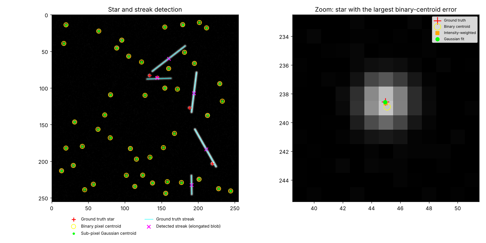

# Milkyway: Star and Streak Detection with Sub-pixel Centroiding

A classical, fully deterministic image-processing pipeline inspired by the star trackers used in spacecraft Attitude Determination and Control Systems (ADCS). It simulates noisy astronomical images, detects star-like blobs and moving-object streaks, estimates star centers with sub-pixel accuracy, and **measures** how accurate each step is against known ground truth.



*Left: ground-truth stars (red +), detected stars (yellow circles, green dots) and streaks (cyan lines, magenta x). Stars that sit on a streak merge with it and are lost (red + with no circle). Right: one star, zoomed, showing how far each centroid method lands from the truth.*

## Results

Default settings (256 x 256 image, 50 stars, 5 streaks, noise sigma 3), pooled over 20 random scenes:

| Metric | Value |
| --- | --- |
| Star recall / precision | 94.3% / 99.9% |
| Streak recall / precision | 90.0% / 97.8% |
| Localization error, binary pixel centroid | 0.138 px |
| Localization error, intensity-weighted centroid | 0.032 px |
| Localization error, sub-pixel Gaussian fit | **0.014 px** |
| Fitted width, stars (sigma x, sigma y) | (1.20, 1.20) px |
| Fitted width, streaks (sigma x, sigma y) | (4.01, 2.97) px |

Localization error is RMSE against the true star position, over matched stars. Reproduce with `python -m src.run_pipeline --seed 0 --trials 20`.

### Sensitivity to noise

Star peaks are 150 to 400 counts above background; noise is Gaussian with the sigma shown.

| Noise sigma | Star recall | Binary (px) | Weighted (px) | Gaussian fit (px) |
| --- | --- | --- | --- | --- |
| 3 | 94.3% | 0.138 | 0.032 | **0.014** |
| 10 | 95.4% | 0.165 | 0.084 | **0.047** |
| 20 | 93.4% | 0.226 | **0.169** | 0.270 |
| 40 | 62.0% | 0.317 | 0.276 | 0.268 |

The Gaussian fit is the most accurate method at low and moderate noise. At noise sigma 20 the simple intensity-weighted centroid is better, because the six-parameter fit becomes unreliable on noisy patches. At sigma 40 the star recall itself drops to 62%, so the detector is the bottleneck.

## How it works

1. **Simulate** (`src/simulate.py`): stars are Gaussian PSFs rendered at sub-pixel positions with a minimum separation; streaks are linear trails with a Gaussian cross-section; plus a flat background and Gaussian noise. A seed makes every scene reproducible.
2. **Detect** (`src/detect.py`): estimate background and noise robustly (median and MAD), threshold at background + 5 sigma, then label connected components.
3. **Localize**: three estimates per blob: binary (unweighted mean of blob pixels), intensity-weighted centroid, and a 2D Gaussian fit on an 11 x 11 patch.
4. **Classify**: blob elongation from second moments separates round stars from streaks. The fitted sigmas then confirm it: streak blobs fit far wider than the 1.2 px PSF.
5. **Evaluate** (`src/evaluate.py`): one-to-one matching to ground truth (Hungarian, 3 px gate), then recall, precision and RMSE.

## Quickstart

```bash
pip install -r requirements.txt

python -m src.run_pipeline                          # 20 scenes, saves outputs/detection_example.png
python -m src.run_pipeline --trials 50 --noise 10   # change conditions
python -m src.run_pipeline --show                   # open the figure window
python -m src.run_pipeline --save-data              # also write a scene and its labels to data/synthetic/
```

Other options: `--stars`, `--streaks`, `--threshold`, `--seed`, `--out-dir`, `--no-plot`.

## Project structure

```
milkyway/
├── src/
│   ├── simulate.py       # Synthetic star field and streak generator
│   ├── detect.py         # Thresholding, connected components, centroiding, Gaussian fit
│   ├── evaluate.py       # Matching to ground truth and metrics
│   └── run_pipeline.py   # Command-line runner and plots
├── tests/                # Tests that pin down the claims above
├── data/synthetic/labels # Sample ground-truth labels (seed 0)
├── docs/                 # README figure
└── requirements.txt
```

## Tests

```bash
pip install pytest
python -m pytest
```

The tests check that scenes are reproducible, that the Gaussian fit recovers a noiseless star to within 0.01 px, that recall and precision stay high, and that the sub-pixel fit beats the binary centroid.

## Limitations

- **Simulated data only.** The Gaussian fit model is the same shape the simulator uses, so these accuracies are best-case; real sensors add non-Gaussian PSFs, hot pixels, and a varying background.
- **Overlaps are lost.** A star that overlaps a streak merges into it, which accounts for most of the roughly 6% missed stars. The stars are also kept at least 10 px apart.
- **The fit is axis-aligned**, so it cannot describe a diagonal streak. Its sigma values are a cue, not an accurate shape model, which is why classification uses blob elongation.
- **Fixed threshold rule.** The 5-sigma threshold is not adaptive, and the detector degrades at high noise (see the table above).

This project favors explainable, deterministic algorithms over learned models, which is the usual preference in safety-critical and resource-constrained flight systems.
